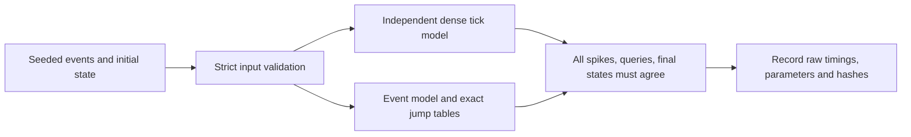

# Integer Neuron Lab

**Project led by [kangchenghaokang-dot](https://github.com/kangchenghaokang-dot).** I initiated the
broader research exploration, set its goals and practical constraints, and
steered it toward reproducible public artifacts. This project reflects that
focus on clear questions, meaningful comparisons and checkable evidence.
See [my contributions and the implementation division](CONTRIBUTIONS.md).

A small, dependency-free experiment in **exact finite-integer dynamics**:
when can an event-driven implementation skip silent ticks without changing
any spike, requested state, or final state?

This is a reproducibility and verification project. It implements a deliberately
simple LIF-inspired integer model; it does not claim a new neuron model,
event-simulation algorithm, neural-network accelerator, or biological validation.

[中文说明](README.zh-CN.md) · [Numerical contract and proof](docs/contract.md) ·
[Experiments](docs/experiments.md) · [Recorded validation](docs/validation.md) · [AI assistance](AI_USAGE.md)

## Reproduce without installing anything

Use Python 3.10 or newer, from this repository's root:

```sh
python run.py verify
python run.py experiment --output results/demo.json
```

The first command compares the independent dense and event implementations on
40 seeded problems. The second writes 36 configurations (three seeds, six input
patterns, two query schedules), raw host timing samples, output checksums, and a
CSV. No dataset, FPGA, account credential, or network connection is required.

To run the full unit suite, set `PYTHONPATH=src`, then:

```sh
python -m unittest discover -s tests -v
```

In PowerShell use `$env:PYTHONPATH="src"`; in a POSIX shell use
`PYTHONPATH=src python -m unittest discover -s tests -v`.
Optional package installation is `python -m pip install -e .`; packaging tools
may need a download, but runtime and the offline launcher use only the standard
library. The GitHub Actions workflow is included; a workflow file is not evidence
that hosted CI has already run.

## What is being compared?

For each neuron and tick, with state and input in `0..255`:

```text
u = min((230 * state) // 256 + input, 255)
spike = (u >= 127)
state = 0 if spike else u
```

- **Dense reference:** update every neuron at every tick.
- **Event implementation:** process the first tick fully, then advance each
  neuron from its last committed anchor using exact compositions of integer
  decay. Queries project values without moving the anchor; the final query
  materializes the state at the horizon.



Event-driven work can be cheaper on sparse inputs, while frequent queries and
dense events add work. The experiment records both outcomes rather than selecting
only favorable cases. There is no fitted switching threshold or free online
algorithm selector in this project.

## A counterexample worth understanding

Let `g(v) = (230*v)//256`. Then `g(g(2)) = 0`, while
`floor((230/256)**2 * 2) = 1`. Replacing repeated integer updates with one
floating-point exponential changes the numerical model. A difference of one
state unit can change a threshold decision.

There is another boundary: a neuron starting at 142 emits a spike on the first
zero-input tick, because `(230*142)//256 = 127`. Skipping all neurons that have no
input event would miss that spike. Tests cover this explicitly.

## Evidence and limits

- Mathematical boundary checks, complete one-step input/state enumeration,
  randomized sequence comparisons, and invalid-input tests are in `tests/`.
- `results/demo.json` contains an actual local run, with environment and all
  timing samples; rerunning should reproduce numerical checksums with the same
  model and inputs, **not identical wall times or file hashes**.
- Inputs are synthetic. There are no synapses, network feedback, learning,
  refractory period, signed currents, real EEG, or accuracy scores.
- Python nanoseconds are host measurements, not hardware cycles, area, energy,
  or proof of asymptotic speedup. Tables are constructed within each timed event
  invocation. Input generation and serialization are outside the timer.

## Background and contribution

Integrate-and-fire models and event-driven updates are established techniques.
See the [Neuronal Dynamics textbook](https://neuronaldynamics.epfl.ch/online/Ch1.S3.html)
for the continuous model background and the
[Brian2 event-driven update documentation](https://brian2.readthedocs.io/en/stable/user/synapses.html#event-driven-updates)
for a mature simulator's related capability. Neither is copied or claimed to
implement this exact toy integer contract.

The contribution here is an inspectable experimental artifact: explicit semantics,
independent implementations, counterexamples to tempting shortcuts, and a small
reproducible matrix that exposes applicability limits. See [learning tasks](docs/learning.md)
for extensions a maintainer should be able to explain and implement.

MIT licensed. There are no bundled third-party source files or external datasets.
